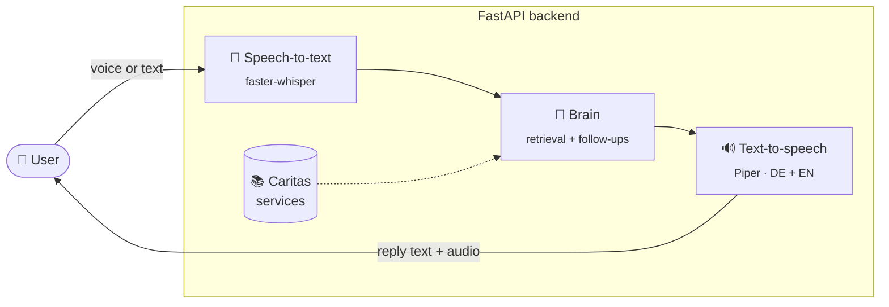

<div align="center">

# 🎙️ Voice to Help
### AI Service Navigator

**Say what you need. Find the help that fits.**

A voice assistant that listens to people describe their situation in **German or English**,
asks the right follow-up questions, and points them to the matching **Caritas support service**,
with the address, phone number and opening hours read aloud.

[](https://www.python.org/)
[](https://fastapi.tiangolo.com/)
[](https://github.com/SYSTRAN/faster-whisper)
[](https://github.com/rhasspy/piper)
[](#)

[Features](#-features) · [How it works](#-how-it-works) · [Quick start](#-quick-start) · [API](#-api) · [Project layout](#-project-layout) · [Status](#-project-status) · [Team](#-team)

</div>

---

## 💡 The idea

Finding the right social service is hard, especially when you are stressed, unsure of the right words, or not a native German speaker.
**Voice to Help** turns that search into a conversation:

> 🗣️ *"Ich weiß nicht mehr weiter, meine Mutter ist pflegebedürftig."*
>
> 🤖 *"Pflegen Sie Ihre Mutter zu Hause?"*
>
> 🗣️ *"Ja, in Würzburg."*
>
> 🤖 *"Die Pflegeberatung für Angehörige passt am besten zu Ihnen. Sie erreichen sie unter …"*

It covers Caritas services across Lower Franconia: Würzburg, Schweinfurt, Aschaffenburg, Kitzingen, Bad Kissingen, Rhön-Grabfeld, Haßberge, Miltenberg and Main-Spessart.

## ✨ Features

| | |
|---|---|
| 🎤 **Speak or type** | Send recorded audio (webm/opus or wav) or plain text |
| 🌍 **Bilingual** | Detects German or English automatically and answers in the same language |
| 🧭 **Asks before it answers** | Follow-up questions narrow things down before a service is recommended |
| 🔎 **Smart matching** | Multilingual E5 embeddings + topic matching, with a boost for the user's region |
| 🆘 **Crisis detection** | Recognises emergencies so they can be handled first |
| 🔊 **Natural speech** | Phone numbers read digit by digit, "Mo–Fr 9–12" spoken as "Monday to Friday, 9 to 12", German place names pronounced correctly in English replies |
| 🔒 **Runs fully locally** | No cloud APIs, no API keys, works on a laptop CPU |
| 🧪 **Mock mode** | `MOCK=1` returns canned answers so the frontend can be built without any models |

## ⚙️ How it works



A full turn (speech-to-text plus speech output) takes about **2 seconds** on a MacBook Air CPU.

## 🚀 Quick start

> **Requires** Python 3.10+

**1. Install**

```bash
cd backend
python3 -m venv .venv && source .venv/bin/activate
pip install -r requirements.txt
```

**2. Try it instantly in mock mode** (no models needed)

```bash
MOCK=1 uvicorn main:app --port 8000
curl -F "text=Ich brauche Hilfe" -F language=auto -F session_id=demo localhost:8000/talk
```

**3. Run the real voice pipeline**

```bash
python -m piper.download_voices --download-dir models de_DE-thorsten-medium en_US-lessac-medium
uvicorn main:app --host 0.0.0.0 --port 8001
```

Then open **http://localhost:8001/docs** for interactive API docs.

> [!NOTE]
> The first real start downloads the Whisper model (~500 MB). `/health` shows `"ok": false` until it is loaded.

📖 Configuration, testing with recorded speech and all environment variables: [`backend/README.md`](backend/README.md)

## 📡 API

| Method | Endpoint | Description |
|---|---|---|
| `POST` | `/talk` | Send `audio` **or** `text`, plus `language` (`auto` · `de` · `en`) and `session_id` |
| `GET` | `/audio/{id}.wav` | The spoken reply (kept for 1 hour) |
| `GET` | `/health` | `{"ok": true}` once models are loaded |

<details>
<summary><b>Example <code>/talk</code> response</b></summary>

```json
{
  "session_id": "demo",
  "transcript": "Ich brauche Hilfe",
  "detected_language": "de",
  "reply_text": "Pflegen Sie Ihre Mutter zu Hause?",
  "reply_audio_url": "/audio/3f2a….wav",
  "needs_more_info": true,
  "service": null,
  "timings": { "stt_ms": 0, "nav_ms": 4, "tts_ms": 610, "total_ms": 620 }
}
```

When `needs_more_info` is `false`, `service` contains the recommendation: `name`, `why` it fits, `address`, `phone`, `email`, `website`, `opening_hours` and `languages`.

</details>

<details>
<summary><b>Error codes</b></summary>

Errors look like `{"error": "<code>", "message": "..."}`:

| Code | HTTP | Meaning |
|---|---|---|
| `empty_audio` | 400 | No audio, or the recording is too short |
| `no_speech` | 422 | No speech detected |
| `bad_request` | 400 | Invalid input |
| `server_busy` | 503 | Models still loading or too many requests |
| `internal` | 500 | Unexpected server error |

</details>

## 📁 Project layout

```
ai_call_hackathon/
├── 📄 README.md
├── 🐍 backend/                FastAPI server
│   ├── main.py               entry point · /talk · /audio · /health
│   ├── contracts.py          shared interface between voice layer and brain
│   ├── sessions.py           conversation history (in memory)
│   ├── errors.py             error codes
│   ├── mock.py               canned answers for MOCK=1
│   ├── 🎤 voice/             speech-to-text · text-to-speech · language detection
│   ├── 🧠 brain/             data ingest · retrieval · region detection · crisis check
│   ├── 📚 data/              services, topics, schema
│   ├── 🧪 tests/             retrieval evaluation (DE + EN)
│   ├── models/               Piper voices (git-ignored)
│   └── tmp/audio/            generated replies (git-ignored)
└── 📑 docs/
    ├── pitch-deck.pptx
    ├── Backend_Person_A_Voice_API.pdf
    └── Frontend_Spec_AI_Service_Navigator.pdf
```

## 📊 Project status

| Part | Status |
|---|---|
| Voice layer: speech-to-text, text-to-speech, API | ✅ Working |
| Retrieval: embeddings, region boost, crisis detection | ✅ Working (try `python -m brain.cli "..."`) |
| Conversation logic `brain/navigator.py` | 🚧 Stub: returns a placeholder, not yet connected to retrieval |
| Service data `backend/data/Data_caritas_expanded.xlsx` | ⚠️ Not in the repo, add it to run retrieval |
| Frontend | 📝 Planned, see [`docs/Frontend_Spec_AI_Service_Navigator.pdf`](docs/Frontend_Spec_AI_Service_Navigator.pdf) |

<details>
<summary><b>Backend ownership</b></summary>

The backend was split between two owners, and `contracts.py` is the agreed interface between them:

- **Person A, voice and API:** `main.py`, `voice/`, `sessions.py`, `errors.py`, `mock.py`
- **Person B, brain:** `brain/`, `data/`, `tests/`

</details>

## 👥 Team

Built with ❤️ at a hackathon. Feel free to reach out to any of us!

| | Name | Contact |
|:-:|---|---|
| 👤 | **Rishabh Jain** | [📧 official.rishabh.info@gmail.com](mailto:official.rishabh.info@gmail.com) · [GitHub](https://github.com/Rishabh4691) |
| 👤 | **Harshavardini Gowrisankar** | [📧 Harshahasini1998@gmail.com](mailto:Harshahasini1998@gmail.com) |
| 👤 | **Deekshith Jagadeesh** | [📧 deekshithj1021@gmail.com](mailto:deekshithj1021@gmail.com) |
| 👤 | **Denise Fetzer** | [📧 Denise.fetzer1@gmail.com](mailto:Denise.fetzer1@gmail.com) |
| 👤 | **Akansha Sharma** | [📧 akanshasharmagermany@gmail.com](mailto:akanshasharmagermany@gmail.com) |
| 👤 | **Bhuvana Chandra Thota** | [📧 Thotab15@gmail.com](mailto:Thotab15@gmail.com) |
| 👤 | **Aryan Thakkar** | [📧 aryanthakkar221@gmail.com](mailto:aryanthakkar221@gmail.com) |

<div align="center">

---

⭐ **If you like this project, give it a star!** ⭐

</div>
