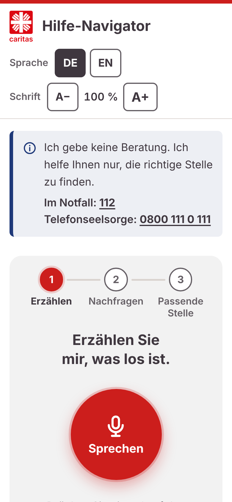
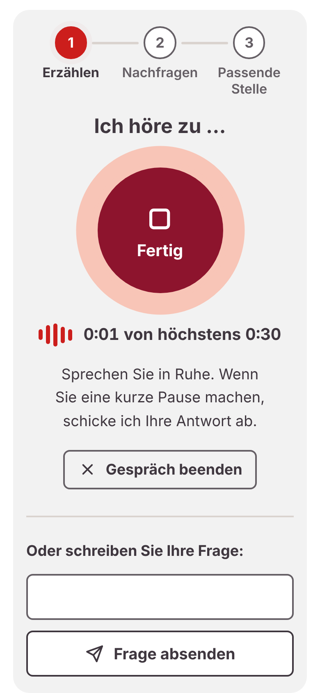
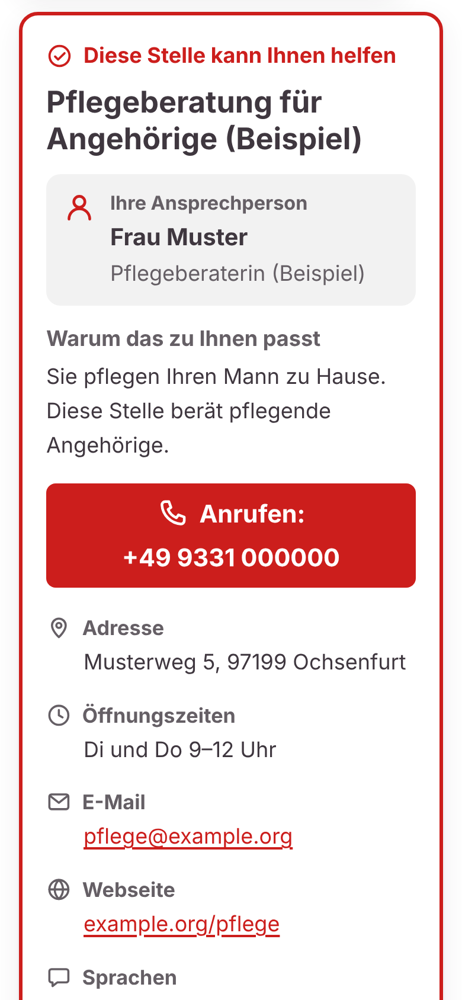
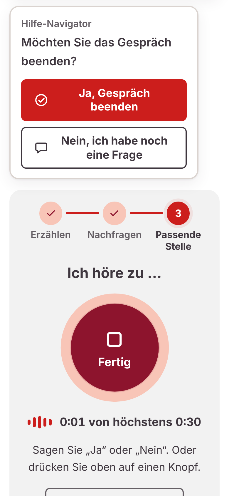
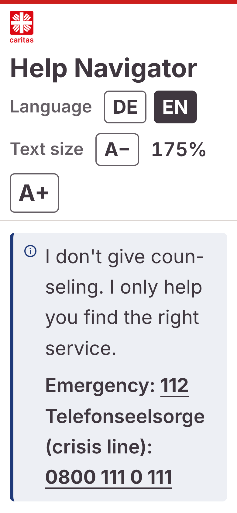
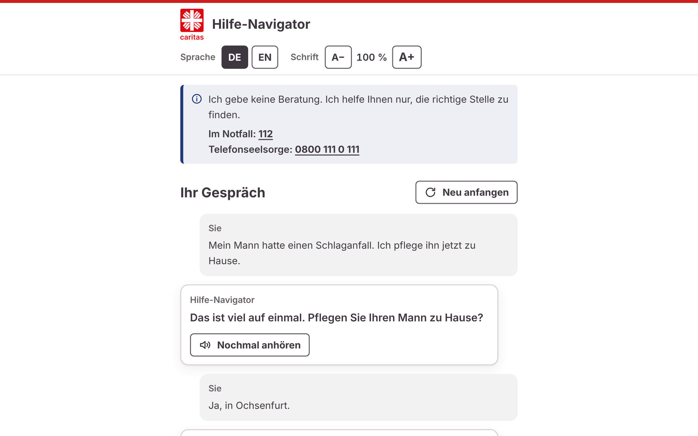

# 🎨 Frontend design concept

A frontend concept for **Voice to Help**, called *Hilfe-Navigator* on screen, designed by **Aryan Thakkar** during the InclusivAI Hackathon on 29 October 2026.

It was finished too late to become part of the submitted build, so this folder only **shares the design as screenshots**. No code from it is in this repository.

The concept is a working web page built for the backend's `POST /talk` API. The screenshots were taken in its test mode.

> [!NOTE]
> Everything in the screenshots is test data: the conversations, the service, the contact person, the address, the phone number and the e-mail are made-up examples. The only real numbers are the emergency number 112 and the Telefonseelsorge crisis line 0800 111 0 111.

## ✨ Ideas in this design

- **One press, then hands-free.** After the first press the page listens again after every answer, so nobody has to keep pressing. A short pause sends the answer.
- **Three clear steps:** *Erzählen* (tell), *Nachfragen* (questions), *Passende Stelle* (matching service).
- **A contact person, not just an address.** The result card names the person to ask for and has a large call button.
- **Ends only when the person is done.** After the answer it asks *„Möchten Sie das Gespräch beenden?“* (Do you want to end the conversation?), answered by voice or with a button.
- **Easy to read for older people:** German and English, text size up to 200%, large buttons, captions for everything that is said, Caritas red and the Inter house font.
- **Safety stays visible:** the notice with 112 and the Telefonseelsorge is shown in every state.

## 📱 Phone

<table>
  <tr>
    <td align="center" valign="top" width="33%">
      
       <b>1 · Start</b> One button to begin
    </td>
    <td align="center" valign="top" width="33%">
      
       <b>2 · Listening</b> Hands-free after the first press
    </td>
    <td align="center" valign="top" width="33%">
      
       <b>3 · Matching service</b> Contact person and call button
    </td>
  </tr>
  <tr>
    <td align="center" valign="top">
      
       <b>4 · End question</b> Answer by voice or button
    </td>
    <td align="center" valign="top">
      
       <b>5 · Large text, English</b> Text size up to 200%
    </td>
    <td></td>
  </tr>
</table>

## 🖥️ Desktop

**6 · Desktop:** the conversation is shown as captions, and every answer can be played again.
